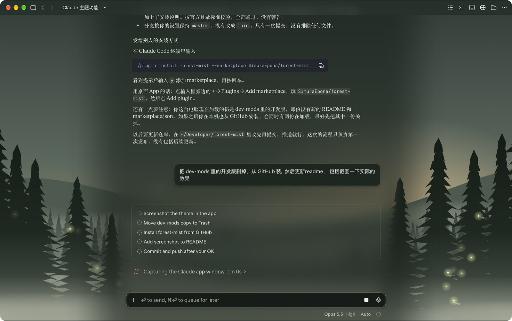

# Forest mist

A Claude Code theme for the desktop and mobile apps: a pine forest at dusk sits behind the conversation, with slow layers of mist drifting between the trees and fireflies blinking on the edges. The interface takes on forest-green colors to match, in both light and dark mode. There is no purple anywhere: the accent is pine green and code literals are a deep teal.

The trees are tallest at the sides, so the middle of the screen, where the text sits, stays calm and readable. The conversation sits on frosted glass over the backdrop.



## Install

At the prompt of a Claude Code terminal session:

```
/plugin install forest-mist --marketplace SimuraEpona/forest-mist
```

Answer `y` to add the marketplace, then press Enter to install for your user. From a shell instead:

```bash
claude plugin install forest-mist --marketplace SimuraEpona/forest-mist
```

In the desktop app, where `/plugin` does not run: click + next to the prompt box, then Plugins, Add marketplace with `SimuraEpona/forest-mist`, then Add plugin.

## Using it

The theme turns on by itself when a session starts. Two slash commands switch it:

- `/plain` takes the theme off
- `/forest` puts it back on

The backdrop moves only when the app plays background animation. If your system has Reduce Motion turned on, or the app finds the animation too heavy on your machine, you see the same scene standing still.

## Changing the scene

The backdrop is generated. Edit `gen-scene.mjs` (colors, tree counts, mist speed) and regenerate it:

```bash
node gen-scene.mjs hooks/scene.ts
```

The app reloads the theme when the file changes.

## License

MIT
